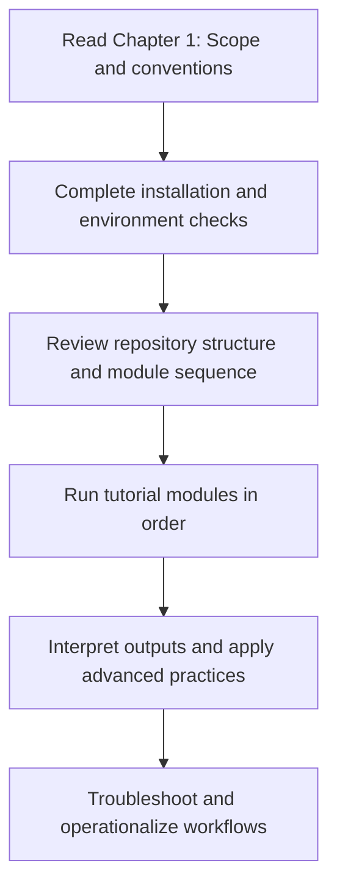

# Chapter 1 - Welcome to DRYP/CUWALID

## Learning Objectives

- Understand the purpose, scope, and intended audience of the handbook.
- Navigate the handbook using chapter groups, module flow, and appendices.
- Confirm the minimum technical prerequisites before starting practical modules.
- Distinguish between conceptual chapters and workflow-execution chapters.

## Background

The DRYP/CUWALID Handbook is designed as an official technical reference for hydrological
modelling and seasonal water forecasting in dryland environments. It is not a workshop
handout and not a collection of notebook notes. Instead, it is a structured, versioned,
and reusable guide that explains scientific concepts, implementation workflows, validation
logic, and troubleshooting practices.

Although examples may use specific case studies (for example, Ethiopia tutorial workflows),
the methods described in this handbook are intended to be transferable to other regions.
The goal is to help users understand what each workflow does, why it is needed, and how to
adapt it to their own operational or research context.

## Required Software

| Component | Version | Notes |
|---|---|---|
| Python | 3.11 | Required baseline for this handbook version |
| CUWALID | 1.x | Target compatibility family |
| DRYP | 2.x | Target compatibility family |
| Git | Latest stable | Recommended for tracking handbook and workflow changes |

## Required Data

| Dataset | Resolution | Units | Purpose | Source |
|---|---|---|---|---|
| None | N/A | N/A | This chapter is orientation-only and does not run model workflows | N/A |

## Repository Files

| File or Folder | Role in Workflow |
|---|---|
| handbook/handbook.md | Master table of contents and handbook entry point |
| handbook/chapters/ | Chapter sources, including tutorial modules and appendices |
| handbook/styles/style-guide.md | Editorial rules and consistency standards |
| handbook/references.bib | Bibliographic source used across chapters |
| handbook/metadata/versioning.md | Compatibility matrix and release policy |

## Intended Audience

This handbook is written for:

- MSc and PhD students in hydrology, water resources, and earth-system modelling.
- Researchers building basin-scale dryland hydrology workflows.
- Government agencies and forecasting centers operating seasonal water outlooks.
- NGOs and practitioners applying hydrological scenarios for planning.
- Developers and analysts extending DRYP/CUWALID pipelines.

The handbook assumes familiarity with command-line basics and scientific Python workflows,
but it does not assume prior DRYP or CUWALID experience.

## Handbook Conventions

To keep chapters readable and consistent, this handbook uses the following conventions:

- Every chapter follows the same section order.
- Workflows are explained by purpose, inputs, outputs, and validation.
- Scientific claims should be linked to primary references.
- Troubleshooting is included as part of normal workflow, not as an afterthought.
- Tutorial examples demonstrate general methods rather than location-specific instructions.

## Scientific Concepts

Dryland hydrology is characterized by strong variability in precipitation, runoff generation,
and groundwater recharge. In many dryland basins, the timing and intensity of rainfall events
can dominate annual water availability. DRYP is built to represent these dynamics in a way
that is scientifically transparent and computationally practical.

CUWALID extends this modelling foundation toward seasonal water forecasting by connecting
data preparation, model execution, post-processing, and forecast communication. Together,
DRYP and CUWALID support a full path from hydrological process understanding to decision-
relevant forecasting products.

At a high level, all practical chapters in this handbook align with a common logic:

1. Prepare consistent input data.
2. Configure and run process-based simulations.
3. Evaluate outputs against observations and expected behavior.
4. Convert outputs into interpretable products.
5. Document assumptions, uncertainties, and reproducibility conditions.

## Workflow

## Step-by-step Guide

1. Read this chapter fully before running notebooks.
2. Open the handbook index and identify the chapter pathway that matches your role:
   learner, analyst, researcher, or operational user.
3. Confirm version compatibility in the handbook metadata before any installation step.
4. Complete installation and repository orientation chapters before module execution.
5. Execute practical modules in sequence to avoid hidden dependency errors.
6. Use validation checklists at the end of each chapter to confirm expected progress.

## Expected Outputs

- Reader understands the scope and purpose of the official handbook.
- Reader can identify where conceptual knowledge ends and execution steps begin.
- Reader can choose the correct chapter sequence for their intended use case.
- Reader understands compatibility targets and documentation conventions.

## Validation Checklist

- [ ] I can explain the difference between DRYP (model core) and CUWALID (forecasting framework).
- [ ] I know where to find installation, repository structure, modules, and appendices.
- [ ] I have checked handbook/software compatibility targets before starting.
- [ ] I understand that module chapters should be completed in order unless explicitly stated otherwise.
- [ ] I know where citations, style guidance, and release/version policy are maintained.

## Troubleshooting

| Symptom | Possible Cause | Recommended Fix |
|---|---|---|
| Unsure where to begin | Skipped orientation and chapter map | Re-read this chapter and open handbook index |
| Installation confusion before any modelling steps | Started from module chapters directly | Continue with Chapter 4 (Installation) then Chapter 5 (Repository Tour) |
| Terminology seems inconsistent across sources | Mixing repository notes with handbook conventions | Use glossary and chapter conventions as primary reference |
| Results differ from expected tutorial behavior | Version mismatch between environment and handbook target | Verify Python/CUWALID/DRYP versions in metadata and recreate environment |

## Summary

Chapter 1 defines how the handbook should be used: as an official, structured, and
versioned technical reference. It establishes audience, scope, conventions, and the
recommended learning sequence. By completing this chapter first, users reduce onboarding
errors and create a stronger foundation for installation, tutorial modules, and advanced
forecasting workflows.

## Further Reading

- DRYP model paper (Quichimbo et al., GMD).
- CUWALID public documentation and tutorial repositories.
- Chapter 4 (Installation) and Chapter 5 (Repository Tour) in this handbook.
