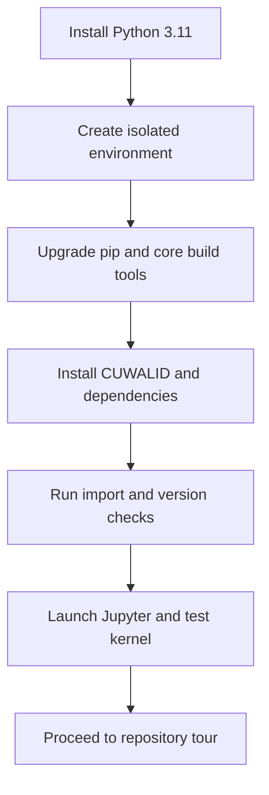

# Chapter 4 - Installation

## Learning Objectives

- Install a clean Python 3.11 environment for DRYP/CUWALID workflows.
- Choose between pip-based and source-based installation paths.
- Verify package imports, dependency health, and runtime readiness.
- Resolve common installation failures on Windows, Linux, and macOS.

## Background

This chapter provides a reproducible installation workflow for the handbook target
stack: Python 3.11, CUWALID 1.x, and DRYP 2.x. The main objective is to ensure that
all users begin from the same baseline so that notebook behavior, calibration routines,
and forecast workflows are consistent across systems.

The recommended approach is:

1. Install Python 3.11.
2. Create an isolated environment.
3. Install CUWALID and required dependencies in that environment.
4. Run verification checks before opening tutorial notebooks.

Avoid installing directly into the system Python environment. Isolated environments
reduce version conflicts and make troubleshooting much easier.

## Required Software

| Component | Version | Notes |
|---|---|---|
| Python | 3.11 | Required baseline for this handbook version |
| pip | bundled with Python 3.11 | Required for package installation |
| venv or conda | latest stable | Strongly recommended for isolation |
| Git | latest stable | Required only for source installation |
| Jupyter | latest stable | Required to run tutorial notebooks |

## Required Data

| Dataset | Resolution | Units | Purpose | Source |
|---|---|---|---|---|
| None | N/A | N/A | Installation chapter does not require modelling inputs | N/A |

## Repository Files

| File or Folder | Role in Workflow |
|---|---|
| handbook/metadata/versioning.md | Declares compatibility targets for this handbook release |
| handbook/metadata/constraints-py311.txt | Pinned dependency baseline for reproducible installs |
| handbook/chapters/05_repository_tour.md | Next chapter after successful installation |

Canonical installation links:

- CUWALID package repository URL: https://github.com/AndresQuichimbo/CUWALID
- CUWALID tutorials repository URL: https://github.com/AndresQuichimbo/CUWALID-tutorials
- DRYP repository URL: https://github.com/AndresQuichimbo/DRYP

## Scientific Concepts

This chapter is technical setup focused. Scientific interpretation begins in later
chapters, but installation quality directly affects scientific reproducibility.

If two users run identical workflows with different dependency versions, they can
obtain different results. Installation discipline is therefore part of scientific
quality control.

## Workflow



## Step-by-step Guide

### 1. Install Python 3.11

Use the official Python distribution for your OS and confirm installation.

Windows PowerShell:

```powershell
py -3.11 --version
```

Linux/macOS shell:

```bash
python3.11 --version
```

Expected result: Python 3.11.x

### 2. Create and activate an isolated environment

Recommended option A: venv

Windows PowerShell:

```powershell
py -3.11 -m venv .venv
.\.venv\Scripts\Activate.ps1
python --version
```

Linux/macOS shell:

```bash
python3.11 -m venv .venv
source .venv/bin/activate
python --version
```

Alternative option B: conda

```bash
conda create -n cuwalid311 python=3.11 -y
conda activate cuwalid311
python --version
```

### 3. Upgrade pip and build tooling

Run after environment activation:

```bash
python -m pip install --upgrade pip setuptools wheel
pip --version
```

### 4. Install CUWALID

Choose one path.

Path A: install from package index (recommended for standard users)

```bash
pip install -i https://test.pypi.org/simple/ --extra-index-url https://pypi.org/simple CUWALID
```

If a stable PyPI release path is confirmed for your target version, you may use:

```bash
pip install cuwalid
```

Path B: install from source (recommended for contributors)

```bash
git clone https://github.com/AndresQuichimbo/CUWALID.git
cd CUWALID
pip install -e .
```

If the project provides optional extras for notebooks or development, install them too:

```bash
pip install -e .[notebooks,dev]
```

### 5. Install Jupyter tooling for tutorials

```bash
pip install jupyterlab ipykernel
python -m ipykernel install --user --name cuwalid311 --display-name "Python (cuwalid311)"
```

### 6. Verify installation

Run a quick import health check:

```bash
python -c "import sys; print(sys.version)"
python -c "import cuwalid; print('cuwalid import ok')"
```

If DRYP is installed as a separate package in your distribution, verify it as well:

```bash
python -c "import dryp; print('dryp import ok')"
```

### 7. Record environment state for reproducibility

```bash
pip freeze > requirements-lock.txt
```

Keep this file with your project outputs when running official experiments.

### 8. Apply the pinned dependency baseline (production mode)

For production or training events where strict reproducibility is required,
install using the pinned baseline in this repository:

```bash
pip install -r handbook/metadata/constraints-py311.txt
```

Then install CUWALID in the same environment.

## Expected Outputs

- Active isolated environment with Python 3.11.
- Successful CUWALID import in command line checks.
- Jupyter kernel available for notebook execution.
- Environment lock file generated for reproducibility.

## Validation Checklist

- [ ] `python --version` reports 3.11.x inside the active environment.
- [ ] `pip --version` points to the active environment path.
- [ ] `import cuwalid` executes without exceptions.
- [ ] `import dryp` executes without exceptions (when distributed separately).
- [ ] Jupyter kernel `Python (cuwalid311)` appears in kernel selection.
- [ ] `requirements-lock.txt` was generated and saved.
- [ ] Optional production baseline `handbook/metadata/constraints-py311.txt` is applied when strict reproducibility is needed.

## Troubleshooting

| Symptom | Possible Cause | Recommended Fix |
|---|---|---|
| `python` reports version other than 3.11 | Different interpreter is active | Reactivate environment and re-check path ordering |
| `pip` installs globally instead of inside environment | Environment not activated | Activate environment and run installs again |
| `ModuleNotFoundError: cuwalid` | Package not installed in active environment | Run `pip install cuwalid` after activation |
| `Permission denied` during install | Attempt to write to protected system directories | Use virtual environment and avoid system-wide pip installs |
| Build fails for compiled dependencies | Missing compiler toolchain or outdated build tools | Upgrade `pip setuptools wheel`; install OS build prerequisites |
| Jupyter kernel does not appear | `ipykernel` not registered | Re-run `python -m ipykernel install --user --name cuwalid311` |
| SSL or network errors during pip install | Restricted network or certificate issue | Retry on stable network; configure proxy/cert settings for pip |
| Source install fails with missing files | Incomplete clone or wrong branch | Re-clone repository and checkout the documented release tag |

### OS-specific Notes

Windows:

- If PowerShell blocks activation scripts, run:

```powershell
Set-ExecutionPolicy -Scope CurrentUser RemoteSigned
```

Linux:

- If `python3.11` is unavailable, install from your distribution package manager
	or use a Python version manager.

macOS:

- Prefer a dedicated Python 3.11 installation over the system Python.
- Confirm command-line tools are installed if build dependencies fail.

## Summary

This chapter establishes a reproducible installation baseline for all handbook
workflows. By using an isolated Python 3.11 environment, installing CUWALID with
explicit dependency checks, and validating Jupyter kernel availability, users can
enter module chapters with significantly lower setup risk.

## Further Reading

- Python packaging documentation.
- pip user guide and dependency management practices.
- Project-specific installation notes in public CUWALID and DRYP repositories.
- Chapter 5 for repository structure and workflow file orientation.
