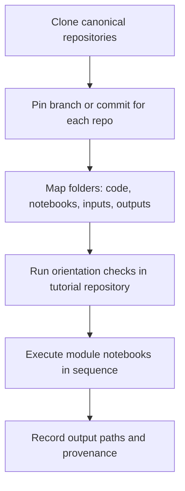

# Chapter 5 - Repository Tour

## Learning Objectives

- Understand the role of each official DRYP/CUWALID repository.
- Locate tutorial notebooks, package code, configuration assets, and outputs efficiently.
- Distinguish editable source content from generated artifacts.
- Apply a reproducible repository navigation pattern before running workflows.

## Background

Most execution errors in early stages are caused by repository navigation issues,
not scientific modelling mistakes. Users often run notebooks from the wrong working
directory, edit generated outputs instead of source files, or mix files from different
repositories.

This chapter defines a single navigation model for the three canonical repositories:

- CUWALID package repository: https://github.com/AndresQuichimbo/CUWALID
- CUWALID tutorials repository: https://github.com/AndresQuichimbo/CUWALID-tutorials
- DRYP model repository: https://github.com/AndresQuichimbo/DRYP

Use this chapter before Module 1 to ensure all users and teams share the same
directory assumptions.

## Required Software

| Component | Version | Notes |
|---|---|---|
| Git | latest stable | Required for cloning and version pinning |
| Python | 3.11 | Required for notebook and script execution |
| JupyterLab | latest stable | Recommended for notebook workflows |

## Required Data

| Dataset | Resolution | Units | Purpose | Source |
|---|---|---|---|---|
| Repository metadata | N/A | N/A | Branch/tag verification and reproducibility | Public repositories |

## Repository Files

| File or Folder | Role in Workflow |
|---|---|
| handbook/handbook.md | Master chapter index for this handbook |
| handbook/chapters/ | Chapter source files and appendices |
| handbook/metadata/versioning.md | Compatibility and release policy |
| handbook/metadata/constraints-py311.txt | Pinned dependency baseline |

## Canonical Repositories and Their Purpose

| Repository | Primary Role | Typical Users |
|---|---|---|
| CUWALID | Python package and model framework implementation | Developers, advanced analysts |
| CUWALID-tutorials | Training and example workflows with notebooks/data scaffolds | New users, instructors |
| DRYP | Core DRYP model code and reference scripts | Model developers, method users |

## Expected Top-level Layout (Observed)

The structures below reflect the public repositories at the time of writing and may
evolve in future commits.

### CUWALID

- `cuwalid/` package source code
- `docs/` documentation sources
- `installers/` install-oriented assets and scripts
- `setup.py` package metadata and dependencies

### CUWALID-tutorials

- `Training/` training notebook workflows
- `Examples/` runnable example content
- `input_template/` template inputs for user runs
- `README.md` quick-start narrative

## Scientific Concepts

This chapter is organizational, but organization quality has direct scientific impact.

- Reproducibility depends on using the same source files and compatible revisions.
- Traceability depends on separating inputs, code, and generated outputs.
- Validation quality depends on being able to map each result back to a specific script,
	notebook, and dependency environment.

## Workflow



## Step-by-step Guide

### 1. Clone the repositories into a common workspace root

```bash
git clone https://github.com/AndresQuichimbo/CUWALID.git
git clone https://github.com/AndresQuichimbo/CUWALID-tutorials.git
```

Recommended local structure:

```text
workspace/
	CUWALID/
	CUWALID-tutorials/
	CUWALID-Handbook/
```

### 2. Pin each repository to a known revision

```bash
git -C CUWALID rev-parse --short HEAD
git -C CUWALID-tutorials rev-parse --short HEAD
```

Record these hashes in your run notes to make results reproducible.

### 3. Confirm top-level folder intent before execution

For each repository, identify:

- Source code folders you should edit.
- Input template folders you should copy from.
- Output folders that are generated and should not be hand-edited.
- Documentation assets that define parameter or workflow expectations.

### 4. Start practical execution from the tutorials repository

Use `CUWALID-tutorials` as the operational entry point for new users.
Use `CUWALID` as implementation and reference layers when deeper inspection is required.

### 5. Keep outputs and source separated

- Do not overwrite templates in `input_template/` directly.
- Create project-specific run directories for generated results.
- Keep a short run manifest with repository commit hashes and environment details.

### 6. Use module order consistently

Follow handbook modules in order:

1. Dataset setup
2. Observation preprocessing
3. Model preprocessing
4. Calibration
5. Post-processing
6. Seasonal forecasting

Avoid skipping ahead unless dependencies are already verified.

## Expected Outputs

- Reader can explain what each canonical repository is for.
- Reader can locate where notebooks should be run and where outputs are produced.
- Reader can identify the correct source layer when debugging.
- Reader can document repository revisions for reproducible runs.

## Validation Checklist

- [ ] I can locate all three canonical repositories and describe their distinct roles.
- [ ] I can identify top-level folders for source code, tutorials, and templates.
- [ ] I can state where I should run beginner workflows (`CUWALID-tutorials`).
- [ ] I can capture and store commit hashes for CUWALID, CUWALID-tutorials, and DRYP.
- [ ] I can distinguish generated outputs from tracked source inputs.
- [ ] I can map each handbook module to its repository entry point.

## Troubleshooting

| Symptom | Possible Cause | Recommended Fix |
|---|---|---|
| Notebook fails to find expected input files | Running from wrong repository or working directory | Start from `CUWALID-tutorials` and verify relative paths |
| Script output appears in unexpected location | Output directory assumptions differ from repository defaults | Check run script parameters and set explicit output paths |
| Team members get different results | Different repository revisions or dependency states | Pin commit hashes and apply the same Python constraints baseline |
| Users edit templates by mistake | Input templates treated as runtime files | Copy templates into run-specific folders before editing |
| Module notebooks appear out of order | Workflow started from ad hoc notebook selection | Follow handbook module sequence and chapter navigation |
| Confusion between CUWALID and DRYP internals | Repository responsibilities not distinguished | Use repository-purpose table and map issue to the right codebase |

## Best Practices for Repository Navigation

- Create one workspace per project cycle with fixed repository revisions.
- Keep a short `run-manifest.md` in each project output folder.
- Never rely on implicit relative paths across repositories.
- Resolve file paths from a single working root.
- When debugging, first identify if the issue is in tutorials, package code, or core model code.

## Summary

This chapter provides a production-grade orientation to the CUWALID repository ecosystem. By mapping canonical repositories, folder responsibilities, and execution entry points up front, users reduce setup ambiguity and make module outcomes easier
to reproduce, validate, and troubleshoot.

## Further Reading

- CUWALID repository: https://github.com/AndresQuichimbo/CUWALID
- CUWALID tutorials repository: https://github.com/AndresQuichimbo/CUWALID-tutorials
- Chapter 6 for Module 1 dataset workflows.
