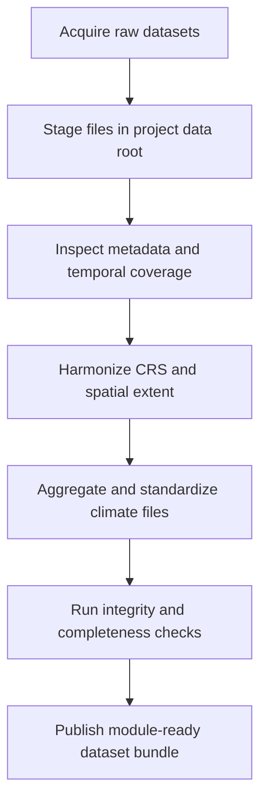

# Chapter 6 - Module 1: Climatological and Physiographic Datasets

## Learning Objectives

- Acquire the baseline climatological and physiographic datasets used by the workflow.
- Understand how dataset provenance, resolution, CRS, and temporal coverage affect model readiness.
- Prepare standardized dataset assets for downstream preprocessing and calibration modules.
- Validate dataset integrity before running DRYP model-preprocessing tasks.

## Background

Module 1 creates the data foundation for the entire DRYP/CUWALID pipeline. This stage
is where most downstream reproducibility issues begin: inconsistent projections,
incomplete temporal coverage, mixed file naming conventions, and path-level confusion.

The objective is not only to download files, but to produce a consistent and auditable
dataset bundle that can be used by later modules without manual fixes.

Observed training workflows in the public tutorials repository include:

- Training/Datasets/download_data.ipynb
- Training/Datasets/processing/grid_preprocessing.ipynb

These notebook paths should be treated as operational references for this module.

## Required Software

| Component | Version | Notes |
|---|---|---|
| Python | 3.11 | Use the same environment validated in Chapter 4 |
| CUWALID | 1.x | Required for package-linked tooling in later modules |
| JupyterLab | latest stable | Recommended for notebook execution |
| gdown | latest stable | Used in observed dataset download workflow |
| xarray | compatible with CUWALID stack | Used for NetCDF inspection and aggregation |

## Required Data

| Dataset | Resolution | Units | Purpose | Source |
|---|---|---|---|---|
| DEM and terrain-derived layers | project-specific | m and derived units | Topographic controls and routing support | Project data bundle |
| Climate forcing inputs | variable | variable | Hydro-climatic forcing for modelling workflows | Project data bundle |
| Potential evapotranspiration time series (example: HAD_pet_YYYY_MM.nc) | monthly source files; yearly merged output | variable | PET forcing preparation and temporal consistency checks | Training/Datasets/processing workflow |
| Regional and continental parameter datasets | variable | variable | Parameter baselines and region-wide setup support | Download workflow assets |

Note: the training notebooks currently reference shared cloud folders and environment-
specific paths. For production use, maintain a local mirror with immutable run manifests.

## Repository Files

| File or Folder | Role in Workflow |
|---|---|
| Training/Datasets/download_data.ipynb | Downloads regional and continental dataset bundles |
| Training/Datasets/processing/grid_preprocessing.ipynb | Aggregates and inspects climate NetCDF files for model-ready use |
| Training/DRYP/regional/AF_global_parameters.ipynb | Regional parameter context for broader DRYP setup |
| Training/DRYP/regional/05_DRYP_preporcessing_water_bodies.ipynb | Water-body preprocessing support for spatial setup |

Canonical repositories for this module:

- https://github.com/AndresQuichimbo/CUWALID-tutorials
- https://github.com/AndresQuichimbo/CUWALID
- https://github.com/AndresQuichimbo/DRYP

## Scientific Concepts

Input datasets control both physical realism and numerical behavior.

- Physiographic datasets (DEM, drainage features, water-body layers) define terrain-driven
	flow organization and boundary assumptions.
- Climate forcing datasets define the atmospheric inputs/outputs of the system.
- Static parameters encode spatial heterogeneity that can strongly affect the behavior of the model.

Three scientific quality principles apply at this stage:

1. Consistency: all spatial layers must share a compatible CRS, extent logic, and pixel/grid conventions.
2. Completeness: forcing time series must be continuous or explicitly gap-flagged.
3. Traceability: every dataset used in model runs must be tied to source, timestamp, and revision.

## Workflow

## Step-by-step Guide

### 1. Confirm repository and environment readiness

- Verify Chapter 4 environment is active.
- Verify repository structure described in Chapter 5.
- Record commit hashes for CUWALID-tutorials, CUWALID, and DRYP.

### 2. Execute the dataset download workflow

Start with Training/Datasets/download_data.ipynb.

Observed pattern:

- Uses gdown.download_folder(...) to retrieve dataset bundles from shared cloud storage.
- Includes distinct destination paths for regional and continental assets.

Production guidance:

- Replace hard-coded absolute paths with project-root relative paths where possible.
- Store data source references in a local manifest file.
- Avoid editing downloaded raw files directly.

### 3. Standardize climate forcing structure

Use Training/Datasets/processing/grid_preprocessing.ipynb to inspect and organize
forcing files. Observed logic includes grouping monthly files such as HAD_pet_YYYY_MM.nc,
then writing yearly merged outputs (for example, HAD_pet_H_2026.nc).

Production guidance:

- Enforce strict filename patterns.
- Validate time coordinate continuity before merging.
- Write standardized outputs to a dedicated processed-data folder.

### 4. Align spatial references and extents

- Confirm each raster and vector source uses the intended project CRS.
- Reproject before clipping or resampling to avoid silent misalignment.
- Keep interpolation/reprojection decisions documented in the run manifest.

### 5. Build a module data manifest

Create a simple CSV or Markdown manifest containing:

- dataset name
- source URL or source identifier
- acquisition date
- preprocessing notebook/script
- output path
- checksum or file size

### 6. Freeze module-ready outputs for downstream modules

Publish a stable folder snapshot for Modules 2 and 3. Treat this snapshot as immutable
input unless a new versioned data-preparation run is performed.

## Expected Outputs

- Downloaded regional and continental baseline datasets in an auditable storage layout.
- Processed climate forcing files with standardized naming and temporal structure.
- Harmonized spatial dataset bundle with documented CRS and extent rules.
- A module-level data manifest ready for handoff to Module 2 and Module 3.

## Validation Checklist

- [ ] All required source datasets are present and listed in a data manifest.
- [ ] Spatial inputs share the expected CRS or have documented conversions.
- [ ] Climate forcing files pass continuity checks for the intended run period.
- [ ] Output dataset naming is consistent with downstream notebook expectations.
- [ ] Processed outputs are separated from raw downloaded files.
- [ ] Repository commit hashes and environment baseline are recorded with the run.

## Troubleshooting

| Symptom | Possible Cause | Recommended Fix |
|---|---|---|
| Dataset download fails or stalls | Invalid cloud link, network policy, or expired access | Re-validate source link and retry on stable network; mirror data to managed storage |
| Notebook writes to inaccessible absolute path | Path values are user-specific from original training context | Replace with local project-relative paths and rerun |
| Missing monthly climate files during merge | Incomplete source download or filename mismatch | Reconcile file inventory against expected pattern before merge |
| Time axis inconsistencies in merged NetCDF | Duplicate months, wrong calendar encoding, or corrupt files | Validate each monthly file and rebuild yearly output |
| CRS mismatch between raster layers | Mixed projections or missing CRS metadata | Assign/repair CRS metadata, then reproject to target CRS |
| Downstream module cannot locate prepared datasets | Processed files saved outside expected folder structure | Standardize output directories and update notebook config paths |

## Best Practices

- Maintain a raw-data folder and a processed-data folder as separate immutable layers.
- Prefer scripted transformations over manual GIS edits.
- Record every preprocessing decision that changes spatial or temporal semantics.
- Keep module data manifests under version control with the handbook project.
- Re-run this module whenever changing study area, forcing period, or base parameter data.

## Summary

Module 1 establishes a reproducible, validated dataset baseline for the DRYP/CUWALID
workflow. By grounding acquisition and preprocessing in concrete notebook pathways and
by enforcing manifest-driven traceability, this module reduces hidden data errors and
stabilizes all downstream modelling and forecasting steps.

## Further Reading

- CUWALID tutorials repository: https://github.com/AndresQuichimbo/CUWALID-tutorials
- CUWALID package repository: https://github.com/AndresQuichimbo/CUWALID
- DRYP repository: https://github.com/AndresQuichimbo/DRYP
- Chapter 7 for observation preprocessing handoff.
