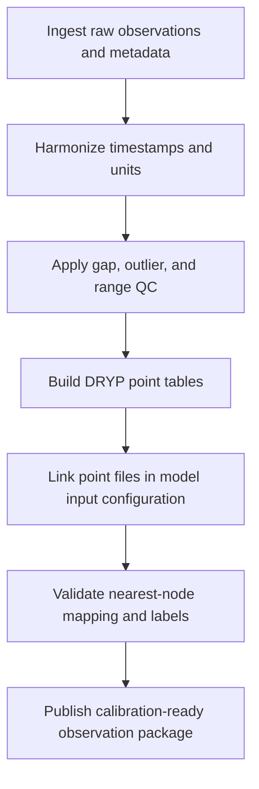

# Chapter 7 - Module 2: Observation Preprocessing

## Learning Objectives

- Convert raw observations into DRYP-ready station and point inputs.
- Apply reproducible quality-control checks for temporal consistency and unit integrity.
- Build clear handoff artifacts for calibration scripts and workflows.
- Validate that observation point files are structurally compatible with DRYP IO logic.

## Background

Module 2 is the bridge between baseline datasets (Module 1) and calibration execution.
In this stage, observation data quality and formatting decisions directly control parameter
identifiability, goodness-of-fit interpretation, and reproducibility of calibration results.

Observed operational references in the tutorials repository include:

- Training/DRYP/catchment/02_DRYP_pre_processing.ipynb
- Training/supporting_material/CLARITY_training/01_DRYP_pre_processing.ipynb

Observed point-input examples include:

- Examples/DRYP/test/input/test_SM_points.csv
- Examples/DRYP/test/input/test_Flumes_points.csv

Observed DRYP IO implementation confirms output-point configuration keys and parsing:

- DRYP/components/DRYP_io.py

## Required Software

| Component | Version | Notes |
|---|---|---|
| Python | 3.11 | Use the same environment validated in Chapter 4 |
| CUWALID | 1.x | Required for tutorial-linked workflows |
| DRYP | mainline compatible with tutorials | IO point parsing behavior verified from DRYP/components/DRYP_io.py |
| JupyterLab | latest stable | Recommended for preprocessing notebooks |
| pandas | compatible with environment | Used for observation and point-table handling |

## Required Data

| Dataset | Resolution | Units | Purpose | Source |
|---|---|---|---|---|
| Discharge observations | station time series | flow units per project standard | Calibration objective and hydrograph comparison | Project observations and provider archives |
| Soil-moisture observations | station time series | volumetric content or equivalent normalized unit | Unsaturated-zone calibration constraints | Project observations and provider archives |
| Groundwater observations (if enabled) | station time series | head/depth per project convention | Groundwater component calibration support | Project observations and provider archives |
| Point location tables for model extraction | point coordinates | East/North coordinates in model CRS | Mapping observation stations to model nodes | DRYP point CSV format examples |

## Repository Files

| File or Folder | Role in Workflow |
|---|---|
| Training/DRYP/catchment/02_DRYP_pre_processing.ipynb | Catchment-focused preprocessing sequence and station preparation |
| Training/supporting_material/CLARITY_training/01_DRYP_pre_processing.ipynb | Alternative training workflow for preprocessing and data staging |
| Examples/DRYP/test/input/test_SM_points.csv | Reference format for soil-moisture point files |
| Examples/DRYP/test/input/test_Flumes_points.csv | Reference format for discharge point files |
| DRYP/components/DRYP_io.py | Canonical IO behavior for reading point tables and mapping to nearest nodes |
| Training/DRYP/calibration/01_gen_parameter_sets.py | Calibration setup handoff target |
| Training/DRYP/calibration/02_DRYP_generate_MC_files.py | Monte Carlo calibration file generation |
| Training/DRYP/calibration/05_DRYP_MC_analysis_performace.py | Calibration performance analysis stage |

## Scientific Concepts

Observation preprocessing quality controls scientific validity as much as model structure.

- Representativeness: station records must correspond to the modeled catchment behavior and
	spatial support assumptions.
- Temporal coherence: timestamps, aggregation intervals, and coverage windows must match
	model forcing and simulation windows.
- Unit consistency: discharge, soil moisture, and groundwater variables must preserve
	physically interpretable units throughout transformations.
- Spatial consistency: point coordinates must be aligned with the model CRS so nearest-node
	mapping is physically meaningful.

## Workflow

## Step-by-step Guide

### 1. Confirm module dependencies and execution context

- Ensure Module 1 outputs are finalized and versioned (Chapter 6).
- Confirm repository revisions for CUWALID-tutorials and DRYP are recorded.
- Execute preprocessing notebooks from the expected tutorials context.

### 2. Stage raw observation records

- Collect discharge, soil-moisture, and optional groundwater records in raw form.
- Preserve source identifiers, station metadata, and original temporal resolution.
- Do not overwrite raw records; create processed copies for transformation steps.

### 3. Standardize temporal axis and units

- Convert all timestamps to a single project time zone or UTC convention.
- Align observation windows to the intended calibration period.
- Enforce unit consistency and document every conversion.

Minimum policy:

- duplicate timestamps must be resolved with documented precedence rules
- missing periods must be flagged explicitly
- unit conversions must be reversible from run notes

### 4. Build DRYP-compatible point files

Observed test files use this point-table schema:

`BH,North,East,Elevation,Label`

Verified examples:

- Examples/DRYP/test/input/test_SM_points.csv
- Examples/DRYP/test/input/test_Flumes_points.csv

Use this schema exactly for model point extraction files unless your DRYP branch
explicitly documents a different parser.

### 5. Configure point files in DRYP input mapping

Observed DRYP IO keys in DRYP/components/DRYP_io.py:

- `fname_DISpoints` for discharge points
- `fname_SMDpoints` for soil-moisture points
- `fname_GWpoints` for groundwater observation points

The same file contains `points_output(...)`, which reads the configured CSVs and maps
each row to nearest model nodes using East/North coordinates.

Production implication:

- coordinate CRS mismatch is a hard failure mode for scientific validity even if code runs
- point counts and station ordering should be checked before calibration

### 6. Apply quality-control checks before calibration handoff

- Verify station completeness over the selected calibration window.
- Flag or remove physically implausible values using variable-specific thresholds.
- Confirm consistency between station metadata and point-table labels.
- Validate nearest-node mapping does not place stations outside the intended domain.

### 7. Prepare calibration handoff package

Before running calibration scripts (for example, under Training/DRYP/calibration):

- freeze processed observation time series
- freeze point tables used for DIS, SMD, and GW mappings
- write a short observation-manifest documenting source, period, unit policy, and QC rules

## Expected Outputs

- Processed and quality-checked observation time series for calibration and evaluation.
- DRYP-compatible point tables following the verified schema.
- Model input mappings that correctly reference DIS, SMD, and optional GW point files.
- Observation-manifest artifacts that make preprocessing reproducible.

## Validation Checklist

- [ ] Observation timestamps are standardized and aligned with simulation/calibration windows.
- [ ] Unit conversions are documented and consistent across all observation variables.
- [ ] Point files follow the required column structure: BH,North,East,Elevation,Label.
- [ ] DRYP input configuration includes correct file paths for fname_DISpoints, fname_SMDpoints, and fname_GWpoints (when used).
- [ ] Nearest-node station mapping has been sanity-checked against expected station locations.
- [ ] Processed outputs and raw sources are separated and both are traceable.
- [ ] Observation-manifest includes provenance, QC steps, and repository revision references.

## Troubleshooting

| Symptom | Possible Cause | Recommended Fix |
|---|---|---|
| Stations map to unexpected nodes | Point coordinates are not in the model CRS | Reproject coordinates to model CRS and regenerate point CSVs |
| Calibration script cannot find point files | Wrong path in DRYP input mapping | Verify paths for fname_DISpoints, fname_SMDpoints, fname_GWpoints |
| Time-series alignment errors during calibration | Mismatched timestamp resolution or time zone | Harmonize temporal resolution and normalize time zone convention |
| Unrealistic fit metrics despite stable model runs | Observation units or QC filtering inconsistent | Re-check unit conversions and outlier/gap policies |
| Missing groundwater constraints | GW point file absent or misconfigured | Provide valid GW points CSV and configure fname_GWpoints |
| Inconsistent station count across files | Point-table edits not synchronized | Regenerate point tables and maintain one authoritative station list |

## Best Practices

- Keep raw and processed observations in separate immutable folders.
- Treat point tables as versioned calibration inputs, not disposable intermediates.
- Include station-level QC decisions in run manifests.
- Re-run this module whenever station inventory, CRS assumptions, or calibration periods change.
- Validate point-node mapping before launching large Monte Carlo calibration batches.

## Summary

Module 2 operationalizes observation data into a reproducible, DRYP-compatible package
for calibration. By grounding preprocessing in verified tutorial paths and confirmed DRYP
IO behavior, this module reduces hidden data-format risk and strengthens the scientific
interpretability of calibration outcomes.

## Further Reading

- CUWALID tutorials repository: https://github.com/AndresQuichimbo/CUWALID-tutorials
- DRYP repository: https://github.com/AndresQuichimbo/DRYP
- Chapter 8 for model preprocessing and calibration continuation.
