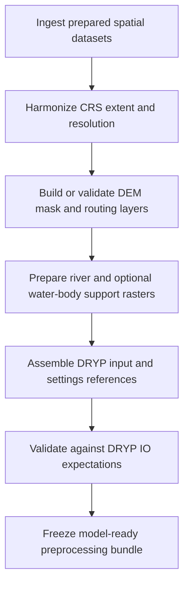

# Chapter 8 - Module 3: Model Preprocessing

## Learning Objectives

- Convert Module 1 and Module 2 artifacts into DRYP model-ready spatial and configuration inputs.
- Build and validate grid, mask, routing, and river-support layers for stable model execution.
- Align preprocessing outputs with the DRYP input-file expectations used at runtime.
- Produce reproducible preprocessing bundles ready for calibration and scenario runs.

## Background

Module 3 transforms prepared datasets into the exact spatial and structural assets expected
by DRYP. This stage links data preparation to executable model inputs, and is therefore the
most common source of hidden runtime failures when file structure, CRS, or routing logic is
inconsistent.

Observed operational references in the tutorials repository include:

- Training/DRYP/catchment/02_DRYP_pre_processing.ipynb
- Training/DRYP/catchment/07_DRYP_preporcessing_water_bodies.ipynb
- Training/DRYP/regional/02_DRYP_pre_pocesing.ipynb
- Training/DRYP/regional/05_DRYP_preporcessing_water_bodies.ipynb
- Training/supporting_material/CLARITY_training/01_DRYP_pre_processing.ipynb

Observed DRYP runtime input mapping and raster loading behavior is implemented in:

- DRYP/components/DRYP_io.py

## Required Software

| Component | Version | Notes |
|---|---|---|
| Python | 3.11 | Use the same baseline validated in Chapter 4 |
| CUWALID | 1.x | Used by tutorials and preprocessing utility workflows |
| DRYP | mainline compatible with tutorials | Runtime IO behavior confirmed in DRYP/components/DRYP_io.py |
| JupyterLab | latest stable | Recommended for notebook-driven preprocessing |
| rasterio | compatible with environment | Used in water-body and raster preprocessing workflows |
| numpy | compatible with environment | Used in grid/routing/water-body transforms |

## Required Data

| Dataset | Resolution | Units | Purpose | Source |
|---|---|---|---|---|
| Prepared DEM and terrain layers | project grid | m | Surface topography for routing and model geometry | Module 1 outputs |
| Catchment mask/domain layers | project grid | binary/categorical | Define active model cells and boundaries | Module 1 outputs |
| Flow direction/routing support layers | project grid | node IDs or routing-ready raster form | Enable overland routing and accumulation logic | Preprocessing notebooks and tools |
| River network and river geometry support | project grid | length/width/elevation-related values | Channel routing and transmission behavior | Preprocessing workflows |
| Water-body layers (where used) | project grid | bathymetry and support fields | Lake/pond/reservoir-ready inputs | Water-body preprocessing notebooks |
| Observation point files | station coordinates | East/North | Runtime extraction and evaluation points | Module 2 outputs |

## Repository Files

| File or Folder | Role in Workflow |
|---|---|
| Training/DRYP/catchment/02_DRYP_pre_processing.ipynb | Catchment preprocessing workflow for DRYP-ready inputs |
| Training/DRYP/catchment/07_DRYP_preporcessing_water_bodies.ipynb | Water-body-specific preprocessing and raster updates |
| Training/DRYP/regional/02_DRYP_pre_pocesing.ipynb | Regional preprocessing sequence |
| Training/DRYP/regional/05_DRYP_preporcessing_water_bodies.ipynb | Regional water-body preprocessing workflow |
| Training/supporting_material/CLARITY_training/01_DRYP_pre_processing.ipynb | Alternative training pipeline for preprocessing tasks |
| Examples/DRYP/testgrid/input/grid_dem.asc | Reference DEM-style raster formatting |
| Examples/DRYP/testgrid/input/grid_mask.asc | Reference mask formatting for active-cell logic |
| Examples/DRYP/testgrid/input/grid_river.asc | Reference river raster support layer |
| Examples/DRYP/testgrid/input/grid_CHB.asc | Reference boundary-condition raster pattern |
| DRYP/components/DRYP_io.py | Canonical mapping for required model input file paths and raster loads |

## Scientific Concepts

Model preprocessing determines how physical assumptions are discretized into simulation
space and therefore directly influences numerical behavior and calibration outcomes.

- Discretization: grid spacing and topology determine routing connectivity and storage
	representation.
- Structural consistency: DEM, mask, flow direction, and river support rasters must be
	co-registered and dimensionally consistent.
- Hydrological realism: river geometry and boundary fields affect runoff concentration,
	transmission losses, and groundwater coupling.
- Computational reproducibility: deterministic preprocessing and explicit manifests reduce
	run-to-run divergence.

## Workflow

## Step-by-step Guide

### 1. Confirm upstream dependencies

- Ensure Module 1 spatial datasets are finalized and versioned.
- Ensure Module 2 observation-point tables exist and are CRS-consistent.
- Record repository revisions for the tutorials and runtime code used.

### 2. Build the spatial base grid package

- Stage DEM, mask, and routing-support candidates in a dedicated preprocessing workspace.
- Enforce one target CRS and one target grid resolution before derived products.
- Reject mixed extents and mixed cell-size assets before proceeding.

Reference raster-style examples are available in the testgrid assets under:

- Examples/DRYP/testgrid/input/grid_dem.asc
- Examples/DRYP/testgrid/input/grid_mask.asc
- Examples/DRYP/testgrid/input/grid_river.asc

### 3. Generate or validate routing and flow-support layers

- Build or verify flow-direction products expected by your DRYP configuration.
- Confirm routing continuity and absence of disconnected active-cell islands unless intentional.
- Ensure mask and routing grids align exactly in dimensions and origin.

In DRYP runtime behavior, model setup reads DEM and related rasters through
DRYP/components/DRYP_io.py and expects coherent raster structures.

### 4. Prepare river and water-body support inputs

- Generate river-support inputs (length/width/elevation or equivalent configured assets).
- Where applicable, run water-body preprocessing notebooks to update DEM and channel
	support layers consistently.
- Keep transformed outputs versioned separately from original source rasters.

Observed notebook patterns include raster loading, transformation, and explicit save steps
for modified outputs in:

- Training/DRYP/catchment/07_DRYP_preporcessing_water_bodies.ipynb
- Training/DRYP/regional/05_DRYP_preporcessing_water_bodies.ipynb

### 5. Assemble DRYP runtime input references

DRYP/components/DRYP_io.py maps key model inputs from the input file, including
surface and routing dependencies such as:

- DEM reference (`fname_DEM`)
- Flow-direction reference (`fname_FlowDir`)
- Mask/domain reference (`fname_Mask`)
- River and related support references (`fname_River`, `fname_RiverWidth`, `fname_RiverElev`)

Production implication:

- file-path correctness is necessary but not sufficient; spatial compatibility must also pass
- a valid-looking input file can still fail scientifically if rasters are misaligned

### 6. Perform structural and scientific validation

- Validate raster dimensions, georeferencing, and nodata semantics across all required layers.
- Verify active domain shape against intended basin boundaries.
- Spot-check routing behavior at key outlets and river corridors.
- Confirm preprocessing outputs remain consistent with calibration objectives.

### 7. Freeze preprocessing handoff package

Before proceeding to calibration and run workflows:

- freeze model-ready rasters and config references
- preserve preprocessing scripts/notebooks used for transformation
- create a preprocessing manifest with source paths, CRS, resolution, and run timestamp

## Expected Outputs

- A coherent DRYP-ready preprocessing bundle containing aligned spatial and support layers.
- Runtime configuration references that map cleanly to required DRYP IO entries.
- Versioned preprocessing artifacts and manifests supporting reproducibility audits.
- Inputs ready for execution and calibration modules without manual path surgery.

## Validation Checklist

- [ ] DEM, mask, routing, and river-support rasters share CRS, extent, and cell size.
- [ ] All required runtime file references are resolved in the selected model input configuration.
- [ ] Active-cell domain and boundary condition layers match the intended catchment design.
- [ ] Water-body preprocessing outputs are dimensionally consistent with core model rasters.
- [ ] Observation point tables from Module 2 remain CRS-compatible with the preprocessed grid.
- [ ] Preprocessing manifest records source provenance, transformations, and output locations.
- [ ] A dry-run or controlled test execution confirms no path or schema-level preprocessing failures.

## Troubleshooting

| Symptom | Possible Cause | Recommended Fix |
|---|---|---|
| Model fails early while reading input rasters | Missing or malformed path mappings in input configuration | Reconcile input-file references with DRYP/components/DRYP_io.py expectations |
| Flow routing looks disconnected or unrealistic | Flow-direction raster misaligned with DEM or mask | Regenerate routing on the finalized target grid and revalidate cell alignment |
| River behavior is unstable or implausible | River support rasters inconsistent with topography | Rebuild river layers from harmonized DEM and verify units/scale assumptions |
| Water-body preprocessing outputs cannot be reused | Derived layers saved with inconsistent dimensions or transforms | Re-run notebook steps with fixed CRS/resolution rules and overwrite only processed targets |
| Calibration underperforms despite clean execution | Structural preprocessing choices conflict with observational constraints | Re-check discretization choices and revisit Module 2/Module 3 consistency checks |
| Runtime references point to legacy files | Manual path edits or mixed run directories | Introduce a single manifest-driven path policy and refreeze outputs |

## Best Practices

- Keep raw source rasters immutable and write all transformed outputs to versioned processed folders.
- Treat preprocessing notebooks/scripts as part of the scientific record for each model run.
- Validate grid alignment before every major scenario or calibration campaign.
- Prefer reproducible script-driven transforms over ad hoc GIS edits.
- Re-run Module 3 whenever domain, resolution, or major terrain/hydrology assumptions change.

## Summary

Module 3 converts prepared datasets into executable DRYP model inputs by enforcing spatial,
structural, and configuration consistency. A production-grade preprocessing process grounded
in verified tutorial workflows and runtime IO expectations reduces fragile runs and improves
calibration interpretability.

## Further Reading

- CUWALID tutorials repository: https://github.com/AndresQuichimbo/CUWALID-tutorials
- DRYP repository: https://github.com/AndresQuichimbo/DRYP
- Chapter 9 for calibration workflow execution.
