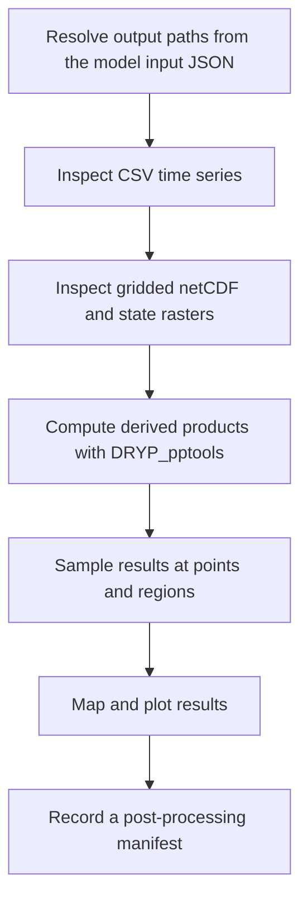

# Chapter 10 - Module 5: Post-processing

## Learning Objectives

- Locate and interpret the time-series, gridded, and state outputs written by a DRYP simulation.
- Derive standard hydrological products from model outputs with `DRYP_pptools`: long-term means, WRSI, total water storage anomalies, anomalies, seasonal averages, aridity index, and soil saturation.
- Sample gridded results at observation points and over user-defined regions.
- Produce maps and figures that are traceable to a specific simulation and post-processing run.

## Background

A DRYP run produces raw model states and fluxes at every grid cell and time step. On their own, these outputs are too large and too detailed to support a decision or a report. Module 5 turns them into a small set of interpretable products: long-term averages, indices, anomalies, and time series at the places that matter to the user.

Post-processing is also the first point at which a user can judge whether a simulation is plausible. Implausible recharge maps, discharge peaks at the wrong time, or storage that drifts without limit usually point back to problems in Modules 3 and 4. For this reason, post-processing should be treated as part of model evaluation, not only as a reporting step.

Observed operational references in the tutorials repository include:

- Training/DRYP/catchment/04_DRYP_post_processing.ipynb
- Training/DRYP/regional/04_DRYP_post_processing.ipynb
- Training/supporting_material/CLARITY_training/03_DRYP_post_processing.ipynb

The post-processing functions are implemented in the CUWALID package:

- cuwalid/tools/DRYP_pptools.py (derived products and sampling)
- cuwalid/tools/DRYP_plot_tools.py (quick plots of CSV outputs)
- cuwalid/dryp/components/DRYP_store_functions.py (output variable names and units)

**Note:** The tutorials describe `DRYP_pptools` as a component that is still under development. Some functions have known limitations, which are listed in the Troubleshooting section. Check them before you rely on a derived product.

## Required Software

| Component | Version | Notes |
|---|---|---|
| Python | 3.11 | Use the same baseline validated in Chapter 4 |
| CUWALID | 1.x (reviewed at commit dd642f7) | Provides `cuwalid.tools.DRYP_pptools`, `DRYP_plot_tools`, and `DRYP_rrtools` |
| DRYP | 2.x (bundled in CUWALID as `cuwalid.dryp`) | Writes the outputs processed in this module |
| pandas | >=2.2, <3 | **pandas 3.x is not supported yet**; see Troubleshooting. Version 2.2 or later is needed for the `YE` alias used in this chapter's examples |
| xarray | compatible with environment | Reads and aggregates netCDF outputs |
| rasterio | compatible with environment | Reads ASCII raster states and parameter rasters |
| matplotlib, pyshp | compatible with environment | Maps and boundary overlays |
| JupyterLab | latest stable | Recommended for notebook-driven post-processing |

## Required Data

| Dataset | Resolution | Units | Purpose | Source |
|---|---|---|---|---|
| Model input file (JSON) | N/A | N/A | Resolves model name and output folder | Module 3 and Module 4 |
| Gridded outputs (`<model_name>_grid.nc`) | model grid, model time step | per variable (see Table 10.1) | Spatial and temporal analysis | DRYP simulation |
| Riparian and pond gridded outputs (`_gridrp.nc`, `_gridpnd.nc`) | model grid | per variable | Focused recharge and water-body analysis | DRYP simulation (when enabled) |
| Domain-average time series (`<model_name>_avg.csv`) | domain mean, model time step | per variable | Water balance overview | DRYP simulation |
| Point time series (`<model_name>_p_<var>.csv`) | output points | per variable | Station-level evaluation | DRYP simulation |
| Final state rasters (`<model_name>_avg_*_ini.asc`) | model grid | m or m3/m3 | Initial conditions for later runs | DRYP simulation |
| Soil and aquifer parameter rasters | model grid | m3/m3, mm, - | Saturation and storage calculations | Module 3 inputs |
| Observation point table (CSV with `East`, `North`) | station coordinates | m (projected) | Point sampling | Module 2 outputs |
| Region boundary (shapefile or raster) | vector or model grid | N/A | Zonal statistics and map overlays | User-defined or Module 1 |

## Repository Files

| File or Folder | Role in Workflow |
|---|---|
| Training/DRYP/catchment/04_DRYP_post_processing.ipynb | Main catchment-scale post-processing tutorial (sections 4.1 to 4.3) |
| Training/DRYP/regional/04_DRYP_post_processing.ipynb | Same sequence applied to the regional model |
| Training/supporting_material/CLARITY_training/03_DRYP_post_processing.ipynb | Alternative training version, with updated zonal extraction call |
| Training/DRYP/catchment/06_basin_analysis_tools.ipynb | Sub-basin creation and plotting helpers for basin-level analysis |
| cuwalid/tools/DRYP_pptools.py | Output filename resolution, derived products, point and zonal sampling |
| cuwalid/tools/DRYP_plot_tools.py | `read_json_file`, `plot_avg_var`, `plot_point_var` |
| cuwalid/tools/DRYP_rrtools.py | `create_raster_from_shapefile` for zonal masks |
| cuwalid/dryp/components/DRYP_store_functions.py | Canonical variable names, long names, and units of gridded outputs |

## Scientific Concepts

Post-processing does not change the simulation, but every derived product embeds choices about aggregation, reference periods, and normalisation. These choices must be reported together with the result.

- **Fluxes and states are aggregated differently.** Fluxes such as `pre`, `aet`, or `rch` are summed over each period, so a long-term mean with yearly aggregation is a mean annual total (mm/year). States such as `tht` (soil moisture) and `wte` (water table elevation) are averaged over each period. `calculate_mean_from_netCDF` applies this rule automatically for `tht`, `wte`, and `ssz`.
- **Anomalies depend on the reference period.** An anomaly is the value for a period minus the long-term mean of the same series. In `DRYP_pptools`, the reference is the mean of the processed series itself, so anomalies are relative to the simulated period, not to an external climatology.
- **Total water storage anomaly (TWSA).** DRYP writes the storage change per time step (`twsc`). TWSA is obtained by summing `twsc` per month and accumulating it over time, which gives the storage relative to the start of the analysis period. The implementation notes that surface water storage is not yet included.
- **Water Requirement Satisfaction Index (WRSI).** As implemented, WRSI is the ratio of actual to potential evapotranspiration (AET/PET) per aggregation period. Values close to 1 indicate that the atmospheric demand was met; low values indicate water stress.
- **Aridity index (AI).** AI is the ratio of precipitation to potential evapotranspiration (P/PET), following the UNEP (1997) definition cited in the code.
- **Soil saturation.** Saturation rescales soil moisture between the wilting point and saturation using the parameter rasters of the model, which makes soil moisture comparable across soil types.
- **Point versus areal values.** Point sampling selects the grid cell nearest to each station. A model cell represents an area, so comparisons with point observations carry a scale mismatch that should be acknowledged in any evaluation.

## Workflow



## Step-by-step Guide

### 1. Confirm upstream dependencies

- Confirm that the simulation finished and that the output folder contains at least `<model_name>_grid.nc` and `<model_name>_avg.csv`.
- Keep the same model input JSON used for the run. Post-processing reads the model name and output folder from it.
- Record the commit hashes of CUWALID and CUWALID-tutorials (Chapter 5) and the versions of pandas and xarray.

### 2. Resolve output file names

DRYP names every output from two entries of the model input JSON: `model_name` and `OUTPUT.path_output`. `get_output_filenames` builds all paths from these two entries, so you do not have to type file names by hand.

```python
import cuwalid.tools.DRYP_pptools as pptools
import cuwalid.tools.DRYP_plot_tools as plotcwld

path_input = "model/AW_input.json"          # model input file used for the run
paths = pptools.get_output_filenames(path_input)

paths.path_grid["grid"]                      # gridded outputs (netCDF)
paths.path_csv["avg"]                        # domain-average time series
paths.path_csv["point"]["dis"]               # discharge at output points
paths.path_raster["wte"]                     # final water table (ASCII raster)
```

- Input: the model input JSON.
- Output: an object with three dictionaries, `path_grid`, `path_csv`, and `path_raster`.
- Rationale: one source of truth for paths avoids mixing outputs from different runs.

**Table 10.1 - DRYP output files.** `<out>` is `OUTPUT.path_output` and `<name>` is `model_name`.

| Output | File pattern | Format | Content |
|---|---|---|---|
| Gridded time series | `<out>/<name>_grid.nc` | netCDF | Gridded fluxes and states over time |
| Riparian gridded time series | `<out>/<name>_gridrp.nc` | netCDF | Riparian-zone variables, including focused recharge (`fch`) |
| Pond gridded time series | `<out>/<name>_gridpnd.nc` | netCDF | Pond and small water-body variables |
| Domain average | `<out>/<name>_avg.csv` | CSV | Domain-average time series of all stored variables |
| Riparian and pond averages | `<out>/<name>_avgrp.csv`, `<name>_avgpnd.csv` | CSV | Averages for the riparian zone and ponds |
| Point time series | `<out>/<name>_p_<var>.csv` | CSV | One file per variable, one column per output point |
| Final states | `<out>/<name>_avg_wte_ini.asc`, `_avg_tht_ini.asc`, `_avg_Q_ini.asc`, `_avg_tht_rp_ini.asc`, `_avg_V_pnd_ini.asc` | ASCII raster | Model state at the end of the run, reusable as initial conditions |

**Table 10.2 - Variables stored in gridded outputs** (from `DRYP_store_functions.py`). `dt` is the model output time step.

| Code | Variable | Units |
|---|---|---|
| `pre` | Precipitation | mm/dt |
| `pet` | Potential evapotranspiration | mm/dt |
| `aet` | Actual evapotranspiration | mm/dt |
| `inf` | Infiltration | mm/dt |
| `run` | Runoff | mm/dt |
| `tls` | Transmission losses | mm/dt |
| `fch` | Focused recharge | mm/dt |
| `rch` | Total groundwater recharge | mm/dt |
| `egw` | Groundwater evaporation | mm/dt |
| `gdh` | Groundwater discharge | m3/dt |
| `dis` | Discharge | m3/dt |
| `ssz` | Surface storage | m3/dt |
| `tht` | Soil moisture | m3/m3 |
| `wte` | Water table elevation | m |
| `twsc` | Water storage change | mm |

**Note:** Gridded files use the dimension names `lat` and `lon`, but their values are projected coordinates in metres. Point tables must therefore use the same projected coordinate system as the model grid.

### 3. Inspect time-series outputs

Start with the domain-average file. It is the quickest way to check the overall water balance of a run.

```python
fields = ["pre_0", "rch_0", "aet_0", "gdh_0", "egw_0", "twsc_0", "run_0"]
plotcwld.plot_avg_var(paths.path_csv["avg"], fields=fields, delta_t="1M")
plotcwld.plot_point_var(paths.path_csv["point"]["wte"], fields=["wte_0"], delta_t="1M")
```

- Input: the domain-average CSV and one point CSV.
- Output: monthly plots of the selected columns.
- Rationale: seasonality and order of magnitude are easier to check on aggregated series than on raw daily values.

Column names combine the variable code with an index, for example `aet_0`. In point files, the index is the position of the station in the output point table.

**Tip:** Open the CSV files with `pandas.read_csv` first and list the columns. This shows which variables were stored for this run before you choose fields to plot.

### 4. Inspect gridded outputs and final states

Open the gridded file with xarray and restrict it to the analysis period before any further processing.

```python
import xarray as xr

ds = xr.open_dataset(paths.path_grid["grid"])
ds = ds.sel(time=slice("2001-01-01", "2020-12-31"))   # explicit analysis period
ds["rch"].resample(time="YE").sum().mean("time").plot()   # mean annual recharge
```

- Input: the gridded netCDF file.
- Output: an xarray Dataset limited to the analysis period, and a quick map.
- Rationale: an explicit time slice makes the analysis period visible in the code and avoids the date-handling limitation described in Troubleshooting.

**Warning:** Use ISO dates (`YYYY-MM-DD`) when slicing. Some docstrings in `DRYP_pptools` mention `DD-MM-YYYY`, but xarray interprets dates in ISO format.

Final states (`*_ini.asc`) can be opened with rasterio. They represent the last time step only and are mainly used as initial conditions for subsequent runs.

### 5. Compute derived products

`DRYP_pptools` provides one function per derived product. Each function reads the gridded output, aggregates it in time, and writes a new netCDF file next to the input unless `fname_out` is given.

```python
fname_nc = paths.path_grid["grid"]
fields = ["pre", "inf", "pet", "rch", "aet", "gdh", "egw", "fch", "twsc", "run"]

pptools.calculate_mean_from_netCDF(fname_nc, field=fields, deltat="Y",
                                   fname_out="postpp/AW_grid_mean.nc")
pptools.calculate_WRSI_from_netCDF(fname_nc, fname_out="postpp/AW_grid_wrsi.nc")
pptools.calculate_twsa_from_netCDF(fname_nc, fname_out="postpp/AW_grid_twsa.nc")
pptools.calculate_anomalies_from_netCDF(fname_nc, field="pre",
                                        fname_out="postpp/AW_grid_pre_anomaly.nc")
pptools.calculate_seasonal_average_from_netCDF(fname_nc, var_name="pre", season=[10, 11, 12],
                                               fname_out="postpp/AW_grid_pre_OND.nc")
```

- Input: the gridded netCDF output.
- Output: one netCDF file per product in a dedicated `postpp/` folder.
- Rationale: explicit output names keep products separate from raw outputs and prevent one product from overwriting another.

**Table 10.3 - Derived products available in `DRYP_pptools`.**

| Function | Variables read | Aggregation | Default output suffix | Output variable |
|---|---|---|---|---|
| `calculate_mean_from_netCDF` | list in `field` (`fch` read from `_gridrp.nc`) | sum per period for fluxes, mean for `tht`, `wte`, `ssz`; then mean over time | `_mean.nc` | same codes |
| `calculate_WRSI_from_netCDF` | `aet`, `pet` | mean per period (`deltat`, default monthly) | `_wrsi.nc` | `wsri` |
| `calculate_twsa_from_netCDF` | `twsc` | monthly sum, then cumulative sum | `_twsa.nc` | `twsa` |
| `calculate_anomalies_from_netCDF` | one variable | mean per period minus mean of all periods | `_wrsi.nc` (see Troubleshooting) | same code |
| `calculate_seasonal_average_from_netCDF` | one variable | monthly totals in the season months, averaged per year | `_<season>.nc` | same code |
| `calculate_AI_from_netCDF` | `pre`, `pet` (can be the same file) | mean per period; long-term mean if `average=True` | `_ai.nc` | `ai` |
| `calculate_saturation_from_netCDF` | `tht` plus wilting-point and saturation rasters | none | `_tht_sat.nc` | `tht` |
| `calculate_storage_from_files` | `wte`, `tht` plus terrain, root-depth, saturation, and specific-yield rasters | monthly | `_str_uz.nc`, `_str_sz.nc`, `_str_lakes.nc` | `str_uz`, `str_sz`, `str_lakes` |

Saturation and storage need parameter rasters. Their paths are read from the same model input JSON:

```python
import os

params = plotcwld.read_json_file(path_input)
base = params["path_input"]
path_wp = os.path.join(base, params["UNSATURATED"]["path_uz_theta_wp"])
path_sat = os.path.join(base, params["UNSATURATED"]["path_uz_theta_sat"])

pptools.calculate_saturation_from_netCDF(fname_nc, path_wp, path_sat,
                                         fname_out="postpp/AW_grid_tht_sat.nc")
```

**Tip:** Pass the season as a list of months (`[10, 11, 12]`) rather than a code. Only a few codes are recognised (`MAM`, `OND`, `JF`, `JJSA`, and `JJS` for June to August). Other codes do not raise an error and return an empty selection.

**Note:** The class `grid_pptools` offers shortcuts (`get_mean`, `get_wrsi`, `get_twsa`) that run several of these functions at once. In the current version it reads the legacy text input format rather than the JSON input file. Until this is confirmed, call the individual functions as shown above.

### 6. Sample results at points and regions

Gridded outputs often need to be summarised where observations or decisions exist.

```python
# Time series at station locations (columns East and North, model projection)
df_points = pptools.get_dataframe_point_from_netcdf(fname_nc, "input/stations_utm.csv",
                                                    field="dis")

# Mean time series over a region defined by a shapefile
import cuwalid.tools.DRYP_rrtools as rrtools
rrtools.create_raster_from_shapefile("shp/basin.shp", "input/dem.asc",
                                     "postpp/region_mask.asc")
df_zone = pptools.get_dataframe_zone_from_netcdf(fname_nc, "postpp/region_mask.asc",
                                                 field=["aet", "twsc"])
```

- Input: the gridded output plus a point table or a region boundary.
- Output: pandas DataFrames with a `Date` column and one column per point or variable.
- Rationale: DataFrames can be compared directly with observed series from Module 2 or exported as CSV.

`get_dataframe_zone_from_netcdf` averages all cells with mask values greater than zero. Use the `regionid` argument to select a single region when the mask raster contains several region codes.

### 7. Map and plot results

Maps are clearer when values outside the catchment are masked and the boundary is drawn on top. The catchment notebook (section "Visualising spatial variables") provides helper functions for this: `read_dataset`, `get_mask`, `get_bounds`, `plot_map_raster_by_field`, and `plot_polygon`.

- Mask cells outside the domain with the model mask raster before plotting.
- Use fixed colour limits when comparing maps across runs or scenarios.
- State the variable, units, aggregation, and period in the title or caption of every figure.
- Save figures at a fixed resolution (for example `dpi=300`) in a `fig/` folder next to `postpp/`.

### 8. Record a post-processing manifest

Before sharing results, write a short manifest in the post-processing folder with:

- the simulation input JSON and output folder used;
- the analysis period and aggregation step of each product;
- the function and arguments that produced each file;
- the commit hashes of CUWALID and CUWALID-tutorials and the pandas and xarray versions.

## Expected Outputs

- A `postpp/` folder with derived products: long-term means, WRSI, TWSA, anomalies, seasonal averages, and, where needed, saturation, storage, and aridity index.
- Point and zonal time series as DataFrames or CSV files, ready for comparison with observations.
- Maps and plots in a `fig/` folder, with variable, units, period, and aggregation stated.
- A post-processing manifest that links every product to the simulation and code versions that produced it.

## Validation Checklist

- [ ] All output paths were resolved from the model input JSON with `get_output_filenames`, with no hand-typed file names.
- [ ] The analysis period was applied explicitly with `ds.sel(time=slice(...))` and is the same for all products.
- [ ] Flux products are reported as totals per period (for example mm/year), and state products as averages.
- [ ] Each derived product has its own output file; no default name was reused by two functions.
- [ ] Seasonal products were checked to contain data (not all NaN) for the selected months.
- [ ] Point coordinates and region masks use the same projection and grid as the model.
- [ ] The domain-average water balance is plausible: over the analysis period, precipitation is approximately balanced by evapotranspiration, water leaving the domain, and the change in storage.
- [ ] Every figure states variable, units, aggregation, and period.
- [ ] A post-processing manifest is stored next to the products.

## Troubleshooting

| Symptom | Possible Cause | Recommended Fix |
|---|---|---|
| `ValueError: 'Y' is no longer supported` or `'M' is no longer supported` | pandas 3.x removed the `Y` and `M` frequency aliases used by `DRYP_pptools` | Install pandas 2.x (`pip install "pandas<3"`) in the CUWALID environment |
| Products cover the whole simulation although `start_time` and `end_time` were given | Date arguments are not applied in the current `DRYP_pptools` | Slice the dataset with xarray first and save it, or check results against an explicit `ds.sel(time=slice(...))` |
| `AttributeError: module has no attribute 'extract_dataframe_zone_from_netcdf'` | The function was renamed | Use `get_dataframe_zone_from_netcdf` |
| WRSI file is overwritten or contains anomalies | `calculate_anomalies_from_netCDF` uses the `_wrsi.nc` suffix by default | Always pass `fname_out` |
| Output file appears in the working folder with a name like `_mean.nc` | Default names are built by cutting the path at the first dot | Use paths without `./` or dots in folder names, or pass `fname_out` |
| Seasonal average is empty (all NaN) | Season code not recognised | Pass the season as a list of month numbers |
| `KeyError` for `path_uz_rootdepth` or `path_uz_root` | The root-depth key differs between the input template and the JSON reader | Check which key your input JSON uses and adapt the call |
| Point time series look constant or unrealistic | Station coordinates are in geographic degrees, or outside the grid | Reproject the point table to the model projection (metres) |
| Notebook cannot find files | Absolute paths from the original authors are still in the notebook | Replace them with paths resolved by `get_output_filenames` |

### Known limitations of DRYP_pptools

The following points were found while reviewing `cuwalid/tools/DRYP_pptools.py` (CUWALID commit dd642f7) and are under review with the developers:

- the storage decomposition in `calculate_storage` may not clip negative values as intended, and its input rasters are not flipped as in `calculate_saturation_from_netCDF`;
- `calculate_saturation` normalises by the saturated water content rather than by the range between wilting point and saturation;
- TWSA does not yet include surface water storage.

Results from these functions should be checked independently before use in reports.

## Best Practices

- Never write derived products into the raw output folder; use `postpp/` and `fig/` folders per run.
- Always pass `fname_out` to `DRYP_pptools` functions.
- Apply the analysis period explicitly and report it with every product.
- Compare point outputs with observations at the same aggregation step (for example monthly), not at the raw model time step.
- Re-run Module 5 whenever the simulation, the analysis period, or the package version changes, and update the manifest.

## Summary

Module 5 converts DRYP outputs into products that can be interpreted, evaluated, and communicated. Output paths are resolved from the model input file, outputs are inspected first as time series and then as grids, derived products are computed with `DRYP_pptools`, and results are sampled at points and regions before mapping. Explicit periods, explicit output names, and a manifest make every product traceable. These outputs are also the starting point for the seasonal forecasting workflow in Module 6.

## Further Reading

- CUWALID tutorials repository: https://github.com/AndresQuichimbo/CUWALID-tutorials
- CUWALID repository: https://github.com/AndresQuichimbo/CUWALID
- CUWALID documentation, DRYP pre- and post-processing tools (`docs/source/dryp_processing.rst`)
- UNEP (1997). World Atlas of Desertification, 2nd edition. United Nations Environment Programme.
- Chapter 12 for a detailed description of DRYP outputs, and Chapter 11 for seasonal forecasting.
