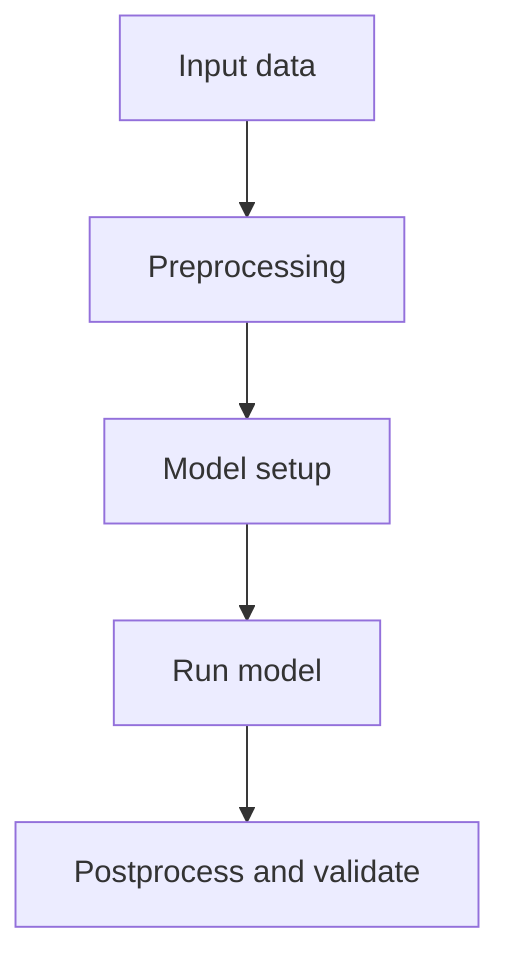

# Chapter XX - Title

## Learning Objectives

- Objective 1
- Objective 2
- Objective 3

## Background

Provide context for why this chapter matters.

## Required Software

| Component | Version | Notes |
|---|---|---|
| Python | 3.11 | |
| CUWALID | 1.x | |
| DRYP | 2.x | |

## Required Data

| Dataset | Resolution | Units | Purpose | Source |
|---|---|---|---|---|
| Example dataset | | | | |

## Repository Files

| File or Folder | Role in Workflow |
|---|---|
| path/to/notebook.ipynb | |

## Scientific Concepts

Explain key process representations and assumptions.

## Workflow

## Step-by-step Guide

1. Step 1.
2. Step 2.
3. Step 3.

## Expected Outputs

List expected files, maps, tables, and diagnostics.

## Validation Checklist

- [ ] Output files generated.
- [ ] Key variables are within expected ranges.
- [ ] Results are reproducible.

## Troubleshooting

| Symptom | Possible Cause | Recommended Fix |
|---|---|---|
| Example error | | |

## Summary

Summarize what was completed and why it matters.

## Further Reading

- Primary model paper.
- Relevant module or repository documentation.
